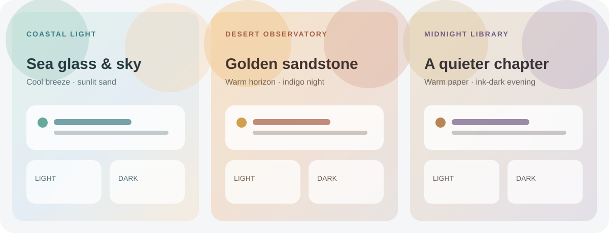

# Ambient Worlds

Three distinct Home Assistant dashboard themes with custom CSS-gradient wallpapers and coordinated light and dark palettes:

- **Coastal Light** — sea glass, pale sand, and open sky.
- **Desert Observatory** — sunlit clay and sandstone by day, deep indigo after dark.
- **Midnight Library** — warm paper and walnut tones, with a quiet ink-dark night mode.



These are palette mockups, not screenshots from Home Assistant. The wallpapers are generated with CSS gradients. The themes do not load remote images, use custom cards, or make network requests.

## Install with HACS

1. In HACS, open **Frontend** and search for **Ambient Worlds**.
2. Download the theme and restart Home Assistant, or reload themes using the `frontend.reload_themes` action.
3. Open your user profile, choose **Coastal Light**, **Desert Observatory**, or **Midnight Library**, and select the light, dark, or system appearance.

If the themes are not shown, check that `configuration.yaml` loads the `themes` directory:

```yaml
frontend:
  themes: !include_dir_merge_named themes
```

Add this only if your configuration does not already load that directory. You can also add this repository in HACS as a custom repository of type **Theme**.

## Background behavior

Each dashboard wallpaper is generated by CSS gradients in the theme file. No remote images or `/local/` files are needed. A background explicitly configured on a dashboard or view takes priority over the theme background.

The themes use Home Assistant's built-in `modes` setting to provide light and dark palettes. Some component-specific colors may keep their own defaults; the themes do not change card layouts.

## Nederlands

Drie verschillende Home Assistant-dashboardthema's met CSS-kleurverlopen en bijpassende lichte en donkere kleuren:

- **Coastal Light** — zeeglas, licht zand en een open lucht.
- **Desert Observatory** — zonverlichte klei en zandsteen overdag, diep indigo na zonsondergang.
- **Midnight Library** — warm papier en walnoothout, met 's nachts rustige inktzwarte tinten.

De afbeelding hierboven toont kleurimpressies en geen schermafbeeldingen van Home Assistant. De achtergronden bestaan uit CSS-kleurverlopen. De thema's laden geen externe afbeeldingen, gebruiken geen aangepaste kaarten en doen geen netwerkverzoeken.

### Installeren met HACS

1. Open in HACS **Frontend** en zoek naar **Ambient Worlds**.
2. Download het thema en herstart Home Assistant, of laad thema's opnieuw met de actie `frontend.reload_themes`.
3. Open je gebruikersprofiel, kies **Coastal Light**, **Desert Observatory** of **Midnight Library**, en selecteer de lichte, donkere of systeemweergave.

Worden de thema's niet getoond? Controleer dan of `configuration.yaml` de map `themes` inlaadt:

```yaml
frontend:
  themes: !include_dir_merge_named themes
```

Voeg dit alleen toe als je configuratie die map nog niet inlaadt. Je kunt deze repository in HACS ook toevoegen als aangepaste repository van het type **Theme**.

### Achtergrond en werking

Elke dashboardachtergrond bestaat uit CSS-kleurverlopen in het themabestand. Externe afbeeldingen en bestanden in `/local/` zijn niet nodig. Een achtergrond die je rechtstreeks op een dashboard of weergave instelt, heeft voorrang op de thema-achtergrond.

De thema's gebruiken de ingebouwde instelling `modes` van Home Assistant voor lichte en donkere kleuren. Sommige componenten behouden mogelijk hun eigen standaardkleuren; de thema's veranderen de kaartindeling niet.

## License / Licentie

MIT. See [LICENSE](LICENSE).
